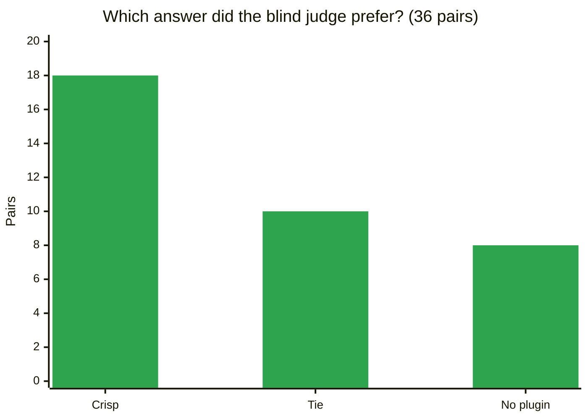
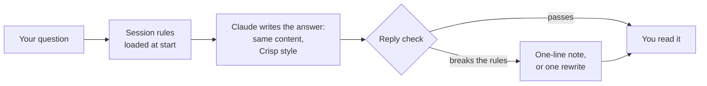

<div align="center">

# ✂️ Crisp

**Same answer. Easier to read. Nothing lost.**

Crisp is a plugin that makes AI answers clear and direct, and it never cuts the facts you need.

[](https://github.com/akshatsingh97/crisp/releases)
[](https://github.com/akshatsingh97/crisp/actions/workflows/ci.yml)
[](LICENSE)
[](#-install-in-30-seconds)

[Why Crisp](#-why-crisp) · [See it](#-see-the-difference) · [Benchmark](#-benchmark) · [Install](#-install-in-30-seconds) · [Commands](#-commands)

</div>

---

## 🎯 Why Crisp

AI answers often bury the point. They open with "Great question!", hedge with "you might want to", and stack 40-word sentences. Tools that fix this by cutting words also cut warnings, steps, and alternatives.

Crisp takes a different rule: **change how the answer is written, never what it contains.**

| What Crisp does | What Crisp never does |
|---|---|
| ✅ Puts the answer in the first sentence | ❌ Remove a fact, step, or warning |
| ✅ States the condition up front: "Yes, if X" | ❌ Drop alternatives or troubleshooting |
| ✅ Numbers the steps and puts warnings before them | ❌ Shorten an answer when you ask for depth |
| ✅ Removes filler, hedges, preambles, and closers | ❌ Touch your code, commands, or quotes |
| ✅ Keeps sentences short and words plain | ❌ Change poems, stories, or jokes |

The writing rules come from **ASD-STE100 Simplified Technical English**, the controlled language that aerospace manuals use so that nobody misreads an instruction.

## 👀 See the difference

A real question from the benchmark: *"I rebased my feature branch and now git push is rejected. Should I use --force?"* (Excerpts of both answers.)

<table>
<tr>
<th width="50%">Without Crisp</th>
<th width="50%">With Crisp</th>
</tr>
<tr>
<td valign="top">

Yes, a rebase rewrites commits, so the remote branch and your local branch have diverged and a plain push is rejected. Force-pushing is the normal fix, but use the safer form:

```bash
git push --force-with-lease
```

Before you push:

- **Check the branch is yours alone.** If teammates also push to it, force-pushing will break their local copies.
- **Run `git fetch` and `git log HEAD..origin/<branch>`.** If it shows commits you don't recognize, someone else pushed.
- **Never force-push `main` or `master`.**

</td>
<td valign="top">

Yes, but use `--force-with-lease`, not plain `--force`, and only if the branch is yours alone. A rebase rewrites commit history, so the remote branch no longer matches yours.

```bash
git push --force-with-lease origin <your-branch>
```

Before you push:

1. Run `git fetch origin`. This makes the lease check accurate.
2. Run `git log HEAD..origin/<your-branch>`. If this shows commits, someone else pushed.
3. If you see their commits, ask them first, or rebase again on top of their work.

If the push is rejected with "stale info", run `git fetch` and check what changed.

</td>
</tr>
</table>

What changed:

- 🎯 The first sentence gives the full answer, with its condition.
- 🔢 Bold lead-ins became numbered steps that you can follow in order.
- 🛟 Crisp explains why to fetch first (it makes the lease check accurate), and adds what to do when the push fails.
- ⚖️ A blind judge picked the Crisp answer in both orders.

<details>
<summary><b>More before-and-after examples</b></summary>

**A question that depends on a condition**

> ❌ *Too short:* "Yes, the retry is safe because the endpoint is idempotent."
>
> ✅ *Crisp:* "Yes, if each retry sends the same idempotency key as the first request. A timeout does not tell you if the first request arrived. Without a key, the retry can create a second order."

**Filler and hedges**

> ❌ "Great question! It's really important to note that you should probably leverage a cache here, as it may seamlessly improve performance. Hope this helps!"
>
> ✅ "Add a cache. It returns repeated results without a database call, so the page loads faster."

</details>

## 📊 Benchmark

We test Crisp the hard way. We ask Claude Code 18 real developer questions and document tasks, 2 times each, with and without Crisp. Then a blind judge compares every pair of answers. The judge does not know which answer used Crisp. It sees each pair two times, in both orders, so that position cannot bias it.



| | No plugin | With Crisp | |
|---|---|---|---|
| Judge's choice (of 36 pairs) | 8 | **18** (10 ties) | 🏆 Preferred over 2× as often |
| Useful information (per answer) | baseline | **+3.3 items added, 2.3 removed** | ➕ Net gain of 1 useful item |
| Critical information (per answer) | baseline | **+0.18 added, 0.10 removed** | 🛡️ More safety notes, not fewer |
| Must-cover facts | baseline | **+3.3 points** | ✅ More complete |
| Accuracy (1 to 10) | baseline | **+0.08** | ✅ Same accuracy |
| Hedges, contractions, dashes (per answer) | 1.25 | **0.36** | ✂️ 71% fewer |
| Sentences over 20 words (per answer) | 0.78 | **0.53** | ✂️ 32% fewer |
| Readability score (0 to 100) | 86 | **93** | 📖 Easier to read |
| "Explain in depth" requests | full length | **100% of full length** | 📚 Depth when you ask |
| Length | 417 words | 450 words | ≈ Same length |

Where Crisp helps most:

| Question type | Crisp preferred | No plugin preferred |
|---|---|---|
| 🛡️ Safety (destructive commands, production changes) | 5 | 1 |
| ⚖️ Decisions ("Should I use X or Y?") | 4 | 0 |
| 🔀 Alternatives ("type or interface?") | 3 | 1 |

<details>
<summary><b>How the benchmark works</b></summary>

- **Isolated runs.** Each run starts in an empty setup, so no other plugin or setting can change the result.
- **Blind pairwise judge.** A separate Claude session with no plugins lists every useful item that only one answer has. It rates each item as critical, useful, or minor, and picks the more useful answer.
- **Both orders.** The judge sees every pair as X/Y and again as Y/X. A pair counts as a win only if both orders agree.
- **Must-cover facts.** A second judge checks each answer against 4 or 5 facts that a correct answer must state.
- **Every mode is tested.** The suite covers answers, the strict level, on-demand mode, and the three commands. It also checks creative writing and code that must compile.
- **22 gates** in `evals/gates.json` turn the numbers into pass or fail.
- **Limits.** The judge is a Claude model that judges Claude text, so family bias is possible. Each run samples the model, so small differences are noise.

Every answer, every verdict, and the full scorecard are in [`evals/results/`](evals/results/). The method is in [`evals/README.md`](evals/README.md).

</details>

<details>
<summary><b>Why we test like this: the bug that our own benchmark caught</b></summary>

Crisp 1.1.0 made answers 17% shorter, and a simple fact checklist said that nothing was missing. The blind pairwise judge disagreed. It preferred the answer with no plugin in **30 of 36 pairs**, because 1.1.0 removed alternatives, troubleshooting steps, and some warnings.

Version 1.2.0 replaced every length limit with one rule: keep everything, and change only how it is written. The judge's verdict went from 1 win and 30 losses to **18 wins and 8 losses**.

The lesson: "shorter" is easy to measure, and "nothing lost" is not. Crisp measures both.

</details>

## ⚙️ How it works



<details>
<summary><b>The rules in short</b></summary>

| Group | Examples |
|---|---|
| **Answer shape** | Answer first. Numbered steps. Warnings before the step. No preamble or closer. |
| **Sentences** | 20 words or fewer. One idea each. Active voice. Condition first: "If X, do Y." Only *can*, *must*, and *will*. |
| **Words** | "use", not "leverage". One word for one concept. No filler such as "simply" or "robust". |
| **Completeness** | Keep every fact, step, warning, example, and alternative. A conditional answer starts "Yes, if X". Depth on request. |
| **Untouchables** | Code, commands, file paths, quotes, names, and numbers stay exactly as they are. |
| **Docs mode** | Patterns for READMEs, runbooks, error messages, release notes, incident reports, and commit messages. |

The full rule set is in [`skills/crisp/SKILL.md`](skills/crisp/SKILL.md).

</details>

## 🚀 Install in 30 seconds

<details open>
<summary><b>Claude Code</b></summary>

```bash
claude plugin marketplace add akshatsingh97/crisp
claude plugin install crisp@crisp
```

Start a new session, and every answer uses Crisp. To try it without installing, run `claude --plugin-dir ./crisp`.

</details>

<details>
<summary><b>Codex</b></summary>

```bash
codex plugin marketplace add akshatsingh97/crisp
codex plugin add crisp@crisp
```

Approve the session hook in `/hooks` before the first run. Use the commands with `$`: `$clarify`, `$tldr`, `$check`, `$level`.

</details>

<details>
<summary><b>Cowork and the Claude app</b></summary>

Download `crisp.plugin` from the [Releases page](https://github.com/akshatsingh97/crisp/releases) and install it. For the Claude app, upload `crisp-skill.zip` as a custom skill.

</details>

<details>
<summary><b>ChatGPT</b></summary>

- **Skills:** download `crisp-chatgpt.zip` from the [Releases page](https://github.com/akshatsingh97/crisp/releases) and upload it. Then start a message with `crisp on`, `clarify`, `tldr`, or `check`.
- **Every chat:** paste the block from [`portable/chatgpt-custom-instructions.md`](portable/chatgpt-custom-instructions.md) into custom instructions. On paid plans, you can paste the full prompt from [`portable/system-prompt.md`](portable/system-prompt.md).

</details>

<details>
<summary><b>Gemini, Perplexity, local models, and APIs</b></summary>

Paste the full prompt from [`portable/system-prompt.md`](portable/system-prompt.md) into a Gem, a Space, or the system message.

</details>

<details>
<summary><b>Cursor, Copilot, Gemini CLI, and other skills tools</b></summary>

```bash
npx skills add akshatsingh97/crisp
```

Or copy [`portable/AGENTS.md`](portable/AGENTS.md) to the root of your repository.

</details>

## 💬 Commands

| Type this | You get |
|---|---|
| Any question | A Crisp answer: the answer first, with nothing left out |
| `/crisp:clarify <text>` | Any text (for example, a ChatGPT answer) rewritten with a bottom line first, every fact kept, and a list of unclear claims |
| `/crisp:tldr` | The last answer in one sentence plus up to three bullets. This is the only command that makes content shorter. |
| `/crisp:check <file>` | A table of problems with fixes, and a readability score |
| `/crisp:level strict` | Strict STE word discipline for the session |
| `/crisp:level off` | Normal answers for the session. `/crisp:level on` turns Crisp back on. |
| "Write a runbook for ..." | Docs mode: steps apart from explanations, warnings before steps |

<details>
<summary><b>Settings</b></summary>

In Claude Code, open `/config` to change the plugin options:

| Option | Choices | Default |
|---|---|---|
| Crisp mode | `always` (every answer) or `on-demand` (only when you ask) | `always` |
| Crisp level | `lite`, `strict`, or `off` | `lite` |
| Reply check | `notify` (one-line note), `fix` (one rewrite), or `off` | `notify` |

In Codex, set `CRISP_MODE`, `CRISP_LEVEL`, and `CRISP_REPLY_CHECK` before you start it.

</details>

## 🔍 The readability checker

Crisp includes a checker with no dependencies. It scores any text from 0 to 100 and lists each problem with its rule.

```bash
python3 skills/crisp/scripts/crisp_check.py answer.md
python3 skills/crisp/scripts/crisp_check.py README.md --type doc --fail-under 80
```

It finds long sentences, hedges, contractions, filler, preambles and closers, conditions after the instruction, bold lead-ins, and more. It ignores code. Use it in CI to keep your docs readable.

## 🧪 Development

```bash
python3 -m unittest discover tests     # unit tests: checker, hooks, package, suite logic
python3 evals/run_suite.py             # full evaluation suite (needs the claude CLI)
claude plugin validate .               # validate the Claude Code plugin
```

When you change a rule, run the evaluation suite before and after, and commit the new results.

<details>
<summary><b>What is in the repository</b></summary>

| Path | What it is |
|---|---|
| `skills/crisp/` | The rule set, docs-mode patterns, vocabulary, and the checker |
| `skills/clarify`, `tldr`, `check`, `level` | The four commands |
| `hooks/` | Session rules at start, and the reply check after each answer |
| `output-styles/` | The `crisp:crisp` output style for Claude Code |
| `portable/` | ChatGPT skill, custom instructions, a system prompt for any LLM, and `AGENTS.md` |
| `evals/` | Evaluation suite, gates, scenarios, and results |
| `tests/` | Unit tests |

</details>

## 📌 Good to know

- Crisp is for facts, explanations, instructions, and documents. Creative writing and marketing copy stay as they are.
- Crisp does not include the ASD-STE100 dictionary, because ASD owns its copyright. The standard is a free download from [asd-ste100.org](https://www.asd-ste100.org/).
- ASD-STE100 is a registered trademark of ASD. Crisp is not affiliated with ASD, and no tool makes text STE-certified.

## 📄 License

MIT. See [`CHANGELOG.md`](CHANGELOG.md) for the version history.
